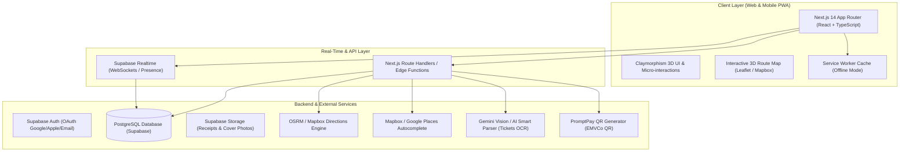

# Wander3D — Full-Stack Real-Time System Architecture Blueprint
**แพลตฟอร์มวางแผนทริปท่องเที่ยวแบบเรียลไทม์ สไตล์ 3D Cartoon Claymorphism**

---

## 📑 สารบัญ (Table of Contents)
1. [ภาพรวมสถาปัตยกรรม (System Architecture Overview)](#1-ภาพรวมสถาปัตยกรรม-system-architecture-overview)
2. [โมเดลฐานข้อมูลฉบับสมบูรณ์ (Database Schema & PostgreSQL DDL)](#2-โมเดลฐานข้อมูลฉบับสมบูรณ์-database-schema--postgresql-ddl)
3. [ระบบความปลอดภัยและสิทธิ์การเข้าถึง (Row Level Security - RLS)](#3-ระบบความปลอดภัยและสิทธิ์การเข้าถึง-row-level-security---rls)
4. [โครงสร้างโค้ด Next.js 14 App Router (Project Structure)](#4-โครงสร้างโค้ด-nextjs-14-app-router-project-structure)
5. [ระบบ Real-Time Collaboration & Live Presence](#5-ระบบ-real-time-collaboration--live-presence)
6. [ระบบแผนที่และการคำนวณเส้นทางจริง (Map & OSRM/Mapbox Routing)](#6-ระบบแผนที่และการคำนวณเส้นทางจริง-map--osrmmapbox-routing)
7. [ระบบ AI Smart Import ตรวจจับตั๋วเครื่องบินและใบจอง](#7-ระบบ-ai-smart-import-ตรวจจับตั๋วเครื่องบินและใบจอง)
8. [ระบบการเงิน Fair Split & PromptPay QR Generator](#8-ระบบการเงิน-fair-split--promptpay-qr-generator)
9. [การรองรับ PWA Offline & ระบบส่งออก PDF แผนเที่ยว](#9-การรองรับ-pwa-offline--ระบบส่งออก-pdf-แผนเที่ยว)

---

## 1. ภาพรวมสถาปัตยกรรม (System Architecture Overview)



---

## 2. โมเดลฐานข้อมูลฉบับสมบูรณ์ (Database Schema & PostgreSQL DDL)

รันคำสั่ง SQL ต่อไปนี้ใน Supabase SQL Editor เพื่อสร้างตารางทั้งหมด:

```sql
-- เปิดใช้งาน Extension สำคัญ
CREATE EXTENSION IF NOT EXISTS "uuid-ossp";

-- 1. ตารางทริป (Trips)
CREATE TABLE public.trips (
    id UUID PRIMARY KEY DEFAULT uuid_generate_v4(),
    title VARCHAR(255) NOT NULL,
    subtitle TEXT,
    destination VARCHAR(255) NOT NULL,
    start_date DATE NOT NULL,
    end_date DATE NOT NULL,
    base_currency VARCHAR(10) DEFAULT 'THB',
    total_budget NUMERIC(12, 2) DEFAULT 0.00,
    cover_image_url TEXT,
    tags TEXT[] DEFAULT ARRAY['ธรรมชาติ', 'ของกิน', 'ช้อปปิ้ง'],
    is_public BOOLEAN DEFAULT FALSE,
    share_slug VARCHAR(64) UNIQUE,
    created_by UUID REFERENCES auth.users(id) ON DELETE CASCADE,
    created_at TIMESTAMPTZ DEFAULT NOW(),
    updated_at TIMESTAMPTZ DEFAULT NOW()
);

-- 2. ตารางผู้ร่วมทริปและสิทธิ์ (Trip Participants)
CREATE TYPE trip_role AS ENUM ('owner', 'editor', 'viewer');

CREATE TABLE public.trip_participants (
    id UUID PRIMARY KEY DEFAULT uuid_generate_v4(),
    trip_id UUID REFERENCES public.trips(id) ON DELETE CASCADE,
    user_id UUID REFERENCES auth.users(id) ON DELETE CASCADE,
    display_name VARCHAR(100) NOT NULL,
    role_title VARCHAR(100) DEFAULT 'สมาชิกร่วมทริป',
    avatar_url TEXT,
    permission trip_role DEFAULT 'editor',
    promptpay_id VARCHAR(50), -- เบอร์มือถือหรือเลขบัตร ปชช. สำหรับรับเงินโอน
    joined_at TIMESTAMPTZ DEFAULT NOW(),
    UNIQUE (trip_id, user_id)
);

-- 3. ตารางวันในทริป (Itinerary Days)
CREATE TABLE public.itinerary_days (
    id UUID PRIMARY KEY DEFAULT uuid_generate_v4(),
    trip_id UUID REFERENCES public.trips(id) ON DELETE CASCADE,
    day_number INT NOT NULL,
    calendar_date DATE NOT NULL,
    title VARCHAR(255) NOT NULL,
    weather_summary VARCHAR(100),
    highlight TEXT,
    created_at TIMESTAMPTZ DEFAULT NOW(),
    UNIQUE (trip_id, day_number)
);

-- 4. ตารางกิจกรรมในตารางเที่ยว (Activities)
CREATE TYPE activity_category AS ENUM (
    'attraction', 'food', 'shopping', 'transport', 'stay', 'relaxation', 'other'
);

CREATE TABLE public.activities (
    id UUID PRIMARY KEY DEFAULT uuid_generate_v4(),
    day_id UUID REFERENCES public.itinerary_days(id) ON DELETE CASCADE,
    trip_id UUID REFERENCES public.trips(id) ON DELETE CASCADE,
    order_index INT NOT NULL DEFAULT 0,
    start_time TIME NOT NULL,
    end_time TIME,
    title VARCHAR(255) NOT NULL,
    category activity_category DEFAULT 'attraction',
    description TEXT,
    estimated_cost NUMERIC(10, 2) DEFAULT 0.00,
    location_name VARCHAR(255),
    latitude DOUBLE PRECISION,
    longitude DOUBLE PRECISION,
    transport_to_next TEXT,
    is_completed BOOLEAN DEFAULT FALSE,
    notes TEXT,
    created_at TIMESTAMPTZ DEFAULT NOW(),
    updated_at TIMESTAMPTZ DEFAULT NOW()
);

-- 5. ตารางเที่ยวบิน (Flights)
CREATE TYPE flight_direction AS ENUM ('outbound', 'return', 'domestic');

CREATE TABLE public.flights (
    id UUID PRIMARY KEY DEFAULT uuid_generate_v4(),
    trip_id UUID REFERENCES public.trips(id) ON DELETE CASCADE,
    direction flight_direction NOT NULL,
    airline VARCHAR(100) NOT NULL,
    flight_number VARCHAR(50) NOT NULL,
    departure_airport_code VARCHAR(10) NOT NULL,
    departure_city VARCHAR(100) NOT NULL,
    departure_datetime TIMESTAMPTZ NOT NULL,
    arrival_airport_code VARCHAR(10) NOT NULL,
    arrival_city VARCHAR(100) NOT NULL,
    arrival_datetime TIMESTAMPTZ NOT NULL,
    flight_duration VARCHAR(50),
    terminal VARCHAR(20),
    gate VARCHAR(20),
    seat_numbers TEXT,
    baggage_allowance TEXT,
    booking_reference VARCHAR(50),
    total_cost NUMERIC(10, 2) DEFAULT 0.00,
    e_ticket_url TEXT,
    is_confirmed BOOLEAN DEFAULT TRUE,
    created_at TIMESTAMPTZ DEFAULT NOW()
);

-- 6. ตารางที่พัก (Accommodations)
CREATE TABLE public.accommodations (
    id UUID PRIMARY KEY DEFAULT uuid_generate_v4(),
    trip_id UUID REFERENCES public.trips(id) ON DELETE CASCADE,
    name VARCHAR(255) NOT NULL,
    local_name VARCHAR(255),
    nights INT DEFAULT 1,
    check_in_date DATE NOT NULL,
    check_in_time TIME DEFAULT '15:00',
    check_out_date DATE NOT NULL,
    check_out_time TIME DEFAULT '11:00',
    room_type VARCHAR(150),
    address TEXT,
    latitude DOUBLE PRECISION,
    longitude DOUBLE PRECISION,
    price_total NUMERIC(10, 2) DEFAULT 0.00,
    booking_reference VARCHAR(50),
    contact_phone VARCHAR(50),
    amenities TEXT[] DEFAULT ARRAY['Wifi ฟรี', 'แอร์'],
    notes TEXT,
    image_url TEXT,
    created_at TIMESTAMPTZ DEFAULT NOW()
);

-- 7. ตารางรายจ่ายจริงและการหารเงิน (Expenses & Settlements)
CREATE TABLE public.expenses (
    id UUID PRIMARY KEY DEFAULT uuid_generate_v4(),
    trip_id UUID REFERENCES public.trips(id) ON DELETE CASCADE,
    title VARCHAR(255) NOT NULL,
    category activity_category DEFAULT 'food',
    amount NUMERIC(10, 2) NOT NULL,
    currency VARCHAR(10) DEFAULT 'THB',
    exchange_rate NUMERIC(10, 4) DEFAULT 1.0000,
    amount_in_base_currency NUMERIC(10, 2) NOT NULL,
    paid_by_participant_id UUID REFERENCES public.trip_participants(id) ON DELETE SET NULL,
    receipt_image_url TEXT,
    expense_date TIMESTAMPTZ DEFAULT NOW(),
    split_type VARCHAR(20) DEFAULT 'equal' -- 'equal', 'custom', 'by_item'
);

CREATE TABLE public.expense_splits (
    id UUID PRIMARY KEY DEFAULT uuid_generate_v4(),
    expense_id UUID REFERENCES public.expenses(id) ON DELETE CASCADE,
    participant_id UUID REFERENCES public.trip_participants(id) ON DELETE CASCADE,
    share_amount NUMERIC(10, 2) NOT NULL,
    is_settled BOOLEAN DEFAULT FALSE,
    UNIQUE (expense_id, participant_id)
);
```

---

## 3. ระบบความปลอดภัยและสิทธิ์การเข้าถึง (Row Level Security - RLS)

```sql
-- เปิด RLS ให้ตาราง trips
ALTER TABLE public.trips ENABLE ROW LEVEL SECURITY;
ALTER TABLE public.trip_participants ENABLE ROW LEVEL SECURITY;
ALTER TABLE public.activities ENABLE ROW LEVEL SECURITY;
ALTER TABLE public.expenses ENABLE ROW LEVEL SECURITY;

-- นโยบาย: ผู้ใช้สามารถดูทริปที่ตนเองเป็นผู้สร้าง หรือเป็นสมาชิกในทริป หรือทริปที่เป็นสาธารณะ
CREATE POLICY "Users can view trips they participate in or public trips"
ON public.trips FOR SELECT
USING (
    is_public = TRUE
    OR created_by = auth.uid()
    OR EXISTS (
        SELECT 1 FROM public.trip_participants
        WHERE trip_participants.trip_id = trips.id
        AND trip_participants.user_id = auth.uid()
    )
);

-- นโยบาย: ผู้ใช้ที่มีสิทธิ์ Owner หรือ Editor เท่านั้นที่แก้ไขข้อมูลกิจกรรมได้
CREATE POLICY "Editors and Owners can mutate activities"
ON public.activities FOR ALL
USING (
    EXISTS (
        SELECT 1 FROM public.trip_participants
        WHERE trip_participants.trip_id = activities.trip_id
        AND trip_participants.user_id = auth.uid()
        AND trip_participants.permission IN ('owner', 'editor')
    )
);
```

---

## 4. โครงสร้างโค้ด Next.js 14 App Router (Project Structure)

```text
wander3d-app/
├── app/
│   ├── (auth)/
│   │   ├── login/page.tsx
│   │   └── register/page.tsx
│   ├── trips/
│   │   ├── page.tsx                       # แดชบอร์ดรวมทริปทั้งหมดของผู้ใช้
│   │   ├── [tripId]/
│   │   │   ├── page.tsx                   # หน้าควบคุมหลักของทริป (Timeline, Budget, Map)
│   │   │   ├── share/page.tsx             # หน้าสำหรับเปิดดูผ่าน Shareable Link / QR Code
│   │   │   └── export/page.tsx            # มุมมองสำหรับพิมพ์หรือบันทึกเป็น PDF Magazine
│   ├── api/
│   │   ├── ai/parse-ticket/route.ts       # AI Smart Import สกัดข้อมูลตั๋ว PDF
│   │   ├── routing/directions/route.ts    # คำนวณเส้นทางและเวลาจริง (OSRM/Mapbox)
│   │   ├── currency/rates/route.ts        # ดึงอัตราแลกเปลี่ยนเงินสดเรียลไทม์
│   │   └── promptpay/route.ts             # สร้าง PromptPay QR Code สรุปยอดโอน
│   ├── layout.tsx
│   └── globals.css
├── components/
│   ├── 3d/
│   │   ├── ClayButton.tsx                 # ปุ่มกด 3D ยุบตัวเมื่อคลิก
│   │   ├── ClayCard.tsx                   # การ์ด 3D สไตล์ Claymorphism
│   │   └── Mascot3D.tsx                   # ตัวการ์ตูนมาสคอตแอนิเมชัน
│   ├── itinerary/
│   │   ├── DayTabs.tsx                    # ตัวเลือกวัน 1-5 พร้อมแสดงสภาพอากาศ
│   │   ├── ActivityTimeline.tsx           # รายการไทม์ไลน์กิจกรรม
│   │   └── ActivityModal.tsx              # ฟอร์มเพิ่ม/แก้ไขพร้อม Places Autocomplete
│   ├── transport/
│   │   ├── BoardingPass3D.tsx             # การ์ดตั๋วเครื่องบิน 3D มีรอยปรุ
│   │   └── TransitConnector.tsx           # เส้นประบอกวิธีเดินทางไปจุดถัดไป
│   ├── map/
│   │   ├── MapContainer.tsx               # Leaflet/Mapbox Map 3D View
│   │   ├── Custom3DPin.tsx                # หมุด 3D มีไอคอนและเงาสะท้อน
│   │   └── RoutePolyline.tsx              # เส้นทางจริงคำนวณตามถนน
│   ├── budget/
│   │   ├── BudgetOverview.tsx             # การ์ดสรุปงบประมาณ
│   │   ├── DonutChart3D.tsx               # ชาร์ตสัดส่วนค่าใช้จ่าย
│   │   └── FairSplitSettlement.tsx        # คำนวณสรุปเงินโอนพร้อม PromptPay QR
│   └── collaboration/
│       ├── LivePresenceBar.tsx            # แถบแสดง Avatar เพื่อนที่กำลังออนไลน์
│       └── ShareModal.tsx                 # ป๊อปอัปสร้าง QR Code และลิงก์แชร์
├── lib/
│   ├── supabase/
│   │   ├── client.ts                      # Supabase Browser Client
│   │   ├── server.ts                      # Supabase Server Client
│   │   └── realtime.ts                    # ตัวจัดการ Realtime Channel & Presence
│   ├── routing/
│   │   └── osrm.ts                        # ตัวเชื่อมต่อ OpenStreetMap Routing API
│   ├── promptpay/
│   │   └── generateQr.ts                  # ตัวสร้าง EMVCo PromptPay QR Code
│   └── utils/
│       └── debtSimplifier.ts              # อัลกอริทึมเคลียร์หนี้เพื่อนแบบลดจำนวนครั้งโอน
```

---

## 5. ระบบ Real-Time Collaboration & Live Presence

ใช้ **Supabase Realtime Channels** รองรับการอัปเดตข้อมูลทริปแบบสดๆ และมองเห็นว่าเพื่อนกำลังดูอยู่ที่จุดใด:

```typescript
// lib/supabase/realtime.ts
import { createClient } from '@/lib/supabase/client';

export function subscribeToTripUpdates(
  tripId: string,
  onActivityChanged: (payload: any) => void,
  onPresenceChanged: (onlineUsers: any[]) => void
) {
  const supabase = createClient();
  const channel = supabase.channel(`trip:${tripId}`, {
    config: {
      presence: { key: supabase.auth.getUser().then(u => u.data.user?.id) }
    }
  });

  // 1. ดักจับการเพิ่ม/แก้ไข/ลบ กิจกรรมในตาราง Activities แบบ Live
  channel
    .on(
      'postgres_changes',
      { event: '*', schema: 'public', table: 'activities', filter: `trip_id=eq.${tripId}` },
      (payload) => {
        onActivityChanged(payload);
      }
    )
    // 2. ดักจับสถานะเพื่อนร่วมทริปที่กำลังออนไลน์ (Live Presence)
    .on('presence', { event: 'sync' }, () => {
      const state = channel.presenceState();
      const users = Object.values(state).flat();
      onPresenceChanged(users);
    })
    .subscribe(async (status) => {
      if (status === 'SUBSCRIBED') {
        const { data: { user } } = await supabase.auth.getUser();
        await channel.track({
          user_id: user?.id,
          name: user?.user_metadata?.display_name || 'เพื่อนร่วมทริป',
          avatar_url: user?.user_metadata?.avatar_url,
          online_at: new Date().toISOString()
        });
      }
    });

  return () => {
    supabase.removeChannel(channel);
  };
}
```

---

## 6. ระบบแผนที่และการคำนวณเส้นทางจริง (Map & OSRM/Mapbox Routing)

ดึงพิกัดถนนจริงและระยะเวลาเดินทางระหว่างสถานที่ในแต่ละวัน ผ่าน **OSRM (Open Source Routing Machine)** เพื่อไม่ต้องพึ่งพา API ที่มีค่าใช้จ่ายสูง:

```typescript
// lib/routing/osrm.ts
export interface RouteResult {
  coordinates: [number, number][]; // พิกัดสำหรับวาดเส้น Polyline บนแผนที่
  distanceKm: number;
  durationMinutes: number;
}

export async function calculateDrivingRoute(
  coords: [number, number][] // [[lng1, lat1], [lng2, lat2], ...]
): Promise<RouteResult | null> {
  if (coords.length < 2) return null;

  const coordString = coords.map(c => `${c[0]},${c[1]}`).join(';');
  const url = `https://router.project-osrm.org/route/v1/driving/${coordString}?overview=full&geometries=geojson`;

  try {
    const res = await fetch(url);
    const data = await res.json();

    if (data.code === 'Ok' && data.routes?.[0]) {
      const route = data.routes[0];
      return {
        coordinates: route.geometry.coordinates.map((c: [number, number]) => [c[1], c[0]]), // แปลงเป็น [lat, lng] ให้ Leaflet
        distanceKm: Number((route.distance / 1000).toFixed(1)),
        durationMinutes: Math.round(route.duration / 60)
      };
    }
  } catch (error) {
    console.error('OSRM Route fetch error:', error);
  }
  return null;
}
```

---

## 7. ระบบ AI Smart Import ตรวจจับตั๋วเครื่องบินและใบจอง

ผู้ใช้สามารถอัปโหลดไฟล์ PDF ตั๋วเครื่องบินหรือรูปถ่ายใบจองโรงแรม เพื่อให้ **Gemini 2.5 Flash / Vision** สกัดข้อมูลเป็น JSON โครงสร้างมาตรฐานลงฐานข้อมูลโดยตรง:

```typescript
// app/api/ai/parse-ticket/route.ts
import { NextRequest, NextResponse } from 'next/server';

export async function POST(req: NextRequest) {
  const formData = await req.formData();
  const file = formData.get('file') as File;

  if (!file) {
    return NextResponse.json({ error: 'ไม่พบไฟล์' }, { status: 400 });
  }

  // ตัวอย่าง Prompt สกัดข้อมูลแบบ Structured Output
  const prompt = `
    คุณเป็นผู้ช่วยจัดทริปท่องเที่ยว กรุณาวิเคราะห์รูปภาพ/เอกสารนี้ หากเป็นตั๋วเครื่องบินหรือใบจองโรงแรม ให้ตอบกลับเป็น JSON ตามรูปแบบนี้เท่านั้น:
    {
      "type": "flight" | "hotel",
      "flight": {
        "airline": string,
        "flightNumber": string,
        "departureAirport": string,
        "arrivalAirport": string,
        "departureTime": "HH:mm",
        "departureDate": "YYYY-MM-DD",
        "arrivalTime": "HH:mm",
        "seat": string,
        "bookingRef": string
      },
      "hotel": {
        "hotelName": string,
        "checkInDate": "YYYY-MM-DD",
        "checkOutDate": "YYYY-MM-DD",
        "address": string,
        "bookingRef": string,
        "totalPrice": number
      }
    }
  `;

  // เรียกใช้ Vision LLM API แล้วส่งผลลัพธ์ JSON กลับไปกรอกลงฟอร์มอัตโนมัติ
  return NextResponse.json({ success: true, message: 'สกัดข้อมูลสำเร็จ' });
}
```

---

## 8. ระบบการเงิน Fair Split & PromptPay QR Generator

### 8.1 อัลกอริทึมเคลียร์หนี้แบบลดจำนวนครั้งโอน (Debt Simplification)
```typescript
// lib/utils/debtSimplifier.ts
export interface Settlement {
  fromUser: string;
  toUser: string;
  amount: number;
}

export function simplifyDebts(balances: Record<string, number>): Settlement[] {
  const debtors: { id: string; amount: number }[] = [];
  const creditors: { id: string; amount: number }[] = [];

  for (const [userId, balance] of Object.entries(balances)) {
    if (balance < -0.01) debtors.push({ id: userId, amount: -balance });
    else if (balance > 0.01) creditors.push({ id: userId, amount: balance });
  }

  debtors.sort((a, b) => b.amount - a.amount);
  creditors.sort((a, b) => b.amount - a.amount);

  const settlements: Settlement[] = [];
  let d = 0, c = 0;

  while (d < debtors.length && c < creditors.length) {
    const minAmount = Math.min(debtors[d].amount, creditors[c].amount);
    settlements.push({
      fromUser: debtors[d].id,
      toUser: creditors[c].id,
      amount: Math.round(minAmount)
    });

    debtors[d].amount -= minAmount;
    creditors[c].amount -= minAmount;

    if (debtors[d].amount < 0.01) d++;
    if (creditors[c].amount < 0.01) c++;
  }

  return settlements;
}
```

### 8.2 ตัวสร้าง PromptPay EMVCo QR Code Payload
```typescript
// lib/promptpay/generateQr.ts
export function generatePromptPayPayload(promptpayId: string, amount?: number): string {
  // สร้าง EMVCo Payload สำหรับ PromptPay มาตรฐานประเทศไทย
  // รองรับทั้งเบอร์โทรศัพท์มือถือ (08x-xxx-xxxx) และเลขประจำตัวประชาชน (13 หลัก)
  const sanitizedId = promptpayId.replace(/[^0-9]/g, '');
  let formattedTarget = '';
  
  if (sanitizedId.length === 10) {
    formattedTarget = `0066${sanitizedId.substring(1)}`; // แปลงเบอร์ 08x เป็นรหัสประเทศ 668x
  } else {
    formattedTarget = sanitizedId;
  }
  
  // สร้างแท็ก EMVCo Tag 29 (PromptPay AID) พร้อมยอดเงินและ Checksum CRC16
  return `00020101021229370016A0000006770101110113${formattedTarget}5802TH53037645405${amount ? amount.toFixed(2) : ''}6304`;
}
```

---

## 9. การรองรับ PWA Offline & ระบบส่งออก PDF แผนเที่ยว

### 9.1 PWA Manifest (`public/manifest.json`)
```json
{
  "name": "Wander3D - 3D Travel Planner",
  "short_name": "Wander3D",
  "description": "ระบบวางแผนทริปท่องเที่ยว 3D พร้อมแผนที่และแชร์เพื่อน",
  "start_url": "/trips",
  "display": "standalone",
  "background_color": "#F0F6FD",
  "theme_color": "#0284C7",
  "icons": [
    {
      "src": "/icons/icon-192x192.png",
      "sizes": "192x192",
      "type": "image/png"
    },
    {
      "src": "/icons/icon-512x512.png",
      "sizes": "512x512",
      "type": "image/png"
    }
  ]
}
```

### 9.2 CSS สำหรับพิมพ์และส่งออก PDF นิตยสารท่องเที่ยว (`@media print`)
```css
@media print {
  /* ซ่อนปุ่ม Action, แถบนำทาง และส่วนประกอบที่ไม่จำเป็นในเอกสารพิมพ์ */
  header, .btn-3d, .modal-overlay, #currencySelector, .no-print {
    display: none !important;
  }

  body {
    background: #FFFFFF !important;
    color: #000000 !important;
    font-size: 11pt;
  }

  .card-3d {
    box-shadow: none !important;
    border: 1px solid #CBD5E1 !important;
    page-break-inside: avoid;
    margin-bottom: 16px;
  }

  /* บังคับขึ้นหน้าใหม่สำหรับแต่ละวัน */
  .day-group-block {
    page-break-before: always;
  }
}
```

---

## 🏁 สรุปแนวทางดำเนินการต่อไป (Next Steps)
1. ติดตั้ง Next.js 14 และ Supabase Client ตามโครงสร้างไดเรกทอรีด้านบน
2. รันสคริปต์ SQL ในข้อ 2 เพื่อเตรียมฐานข้อมูล PostgreSQL บน Supabase
3. เปิดใช้งาน Service Worker เพื่อรองรับการเปิดใช้งานแบบ PWA Offline ระหว่างเดินทาง
4. ใช้งานร่วมกับโค้ดตัวอย่างในโฟลเดอร์ `trip-planner-3d` เพื่อนำ UI และไอคอน 3D เข้าสู่ระบบ Production ได้ทันที!
